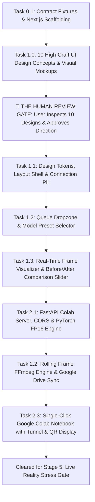

# Sakuga4K — Execution Roadmap (`ROADMAP.md`)

> **Session ID:** `sakuga` | **Date:** 2026-11-20  
> **Status:** APPROVED & ACTIVE | **Selected Archetype:** Next.js 15+ App Router + Decoupled Colab GPU Backend  
> **Lead Architect:** Subagent `systems-architect` | **DAG Slicer:** Subagent `dag-slicer`

---

## 1. Visual Dependency DAG (Directed Acyclic Graph)

---

## 2. Phase 0: Contract Fixtures & Repository Scaffolding

### Task 0.1: Project Directory Structure & Contract Types
- **Files Touched (Max 3):** `package.json`, `tsconfig.json`, `src/types/contracts.ts`
- **Action:** Initialize Next.js 15 TypeScript project config and export typed TypeScript interfaces matching `contracts.json`.
- **Depends On:** None
- **Pre-Flight Test Contract:**
  - *Command:* `node -e "assert(require('./contracts.json').endpoints.length === 5)"`
  - *Expected Result:* Exits with code 0.
- **Status:** [ ] Pending

---

## 3. Phase 1: Track A — Frontend Generative UI & Studio Dashboard

### Task 1.0: 10 High-Craft UI Design Explorations
- **Files Touched (Max 3):** `docs/designs/concepts.md`, `artifacts/` (or generated design mockups)
- **Action:** Generate 10 distinct anime-studio visual design concepts (Cyberpunk Neo-Tokyo, Monolith Zinc, Retro Cel Studio, Frosted Glass HUD, Shonen Crimson, Ghibli Night Emerald, Pro Video Timeline Deck, Split-Screen Inspector, Mecha Terminal, Apple Pro Dark Studio) for human selection.
- **Depends On:** Task 0.1
- **Pre-Flight Test Contract:**
  - *Command:* Verify 10 distinct visual briefs are rendered and inspectable.
  - *Expected Result:* 10 concepts presented to user with clear visual typography, color palette, and layout hierarchy.
- **Status:** [ ] Pending

### 🛑 THE HUMAN REVIEW GATE (MANDATORY PAUSE)
- **Objective:** The user inspects the 10 designs and picks their preferred visual aesthetic for Sakuga4K.
- **Sign-Off Condition:** Production frontend development commences only after user approval.

### Task 1.1: Studio Layout Shell & Tunnel Connection Pill
- **Files Touched (Max 3):** `src/app/layout.tsx`, `src/app/globals.css`, `src/components/Header.tsx`
- **Action:** Implement dark mode studio layout shell with 3-layer surface hierarchy, responsive mobile navigation, and live Cloudflare tunnel handshake status pill (`localStorage` persistence).
- **Depends On:** Human Review Gate Sign-off
- **Pre-Flight Test Contract:**
  - *Command:* `npm run build`
  - *Expected Result:* Zero TypeScript errors, successful static bundle generation.
- **Status:** [ ] Pending

### Task 1.2: Multi-File Drag-and-Drop Queue & Model Preset Selector
- **Files Touched (Max 3):** `src/components/Dropzone.tsx`, `src/components/QueueList.tsx`, `src/components/ClipCard.tsx`
- **Action:** Multi-file drag-and-drop supporting `.mp4`, `.mov`, `.mkv`, `.webm`, clip resolution badges, and model preset selector (`animevideov3` vs `AnimeSharp`).
- **Depends On:** Task 1.1
- **Pre-Flight Test Contract:**
  - *Command:* `npm test -- Dropzone` (or component test assertion)
  - *Expected Result:* Renders queue items and handles multi-file staging.
- **Status:** [ ] Pending

### Task 1.3: Real-Time Frame Visualizer & Before/After Split Comparison Slider
- **Files Touched (Max 3):** `src/components/ProgressVisualizer.tsx`, `src/components/ComparisonSlider.tsx`, `src/app/page.tsx`
- **Action:** Dual progress bars (batch + frame count/ETA), interactive draggable before/after comparison slider, and download triggers (MP4 / ZIP).
- **Depends On:** Task 1.2
- **Pre-Flight Test Contract:**
  - *Command:* `npm run build`
  - *Expected Result:* Exits 0, production bundle passes.
- **Status:** [ ] Pending

---

## 4. Phase 2: Track B — Backend GPU Pipeline & Colab Automation

### Task 2.1: FastAPI Colab Server & PyTorch FP16 Inference Pipeline
- **Files Touched (Max 3):** `backend/main.py`, `backend/models.py`, `backend/requirements.txt`
- **Action:** FastAPI server with CORS, SSE progress endpoint, and PyTorch half-precision (`FP16`) upscaler loading `realesr-animevideov3` and `4x-AnimeSharp`.
- **Depends On:** Task 1.3
- **Pre-Flight Test Contract:**
  - *Command:* `python -m py_compile backend/main.py backend/models.py`
  - *Expected Result:* Exits 0 with zero syntax errors.
- **Status:** [ ] Pending

### Task 2.2: Rolling Frame FFmpeg Engine & Google Drive Auto-Sync
- **Files Touched (Max 3):** `backend/video_processor.py`, `backend/drive_sync.py`, `backend/config.py`
- **Action:** FFmpeg frame extraction, rolling cleanup (deleting raw PNGs per clip after assembly), visually lossless CRF 16 encoding, audio stream copy, and Drive output sync.
- **Depends On:** Task 2.1
- **Pre-Flight Test Contract:**
  - *Command:* `python -m py_compile backend/video_processor.py backend/drive_sync.py`
  - *Expected Result:* Exits 0 with zero syntax errors.
- **Status:** [ ] Pending

### Task 2.3: Single-Click Google Colab Notebook
- **Files Touched (Max 3):** `notebooks/Sakuga4K_Colab_Engine.ipynb`, `backend/start_tunnel.sh`, `README.md`
- **Action:** Create the one-click Google Colab notebook with dependency installation, drive caching, Cloudflare Quick Tunnel startup, and QR code display for mobile pairing.
- **Depends On:** Task 2.2
- **Pre-Flight Test Contract:**
  - *Command:* `node -e "assert(require('fs').existsSync('notebooks/Sakuga4K_Colab_Engine.ipynb'))"`
  - *Expected Result:* Exits 0.
- **Status:** [ ] Pending

---

## 5. Official Handoff Gate
- **Verdict:** Approved Execution Roadmap
- **Entry Ticket to Stage 4:** Signed by `systems-architect` and `dag-slicer`.
