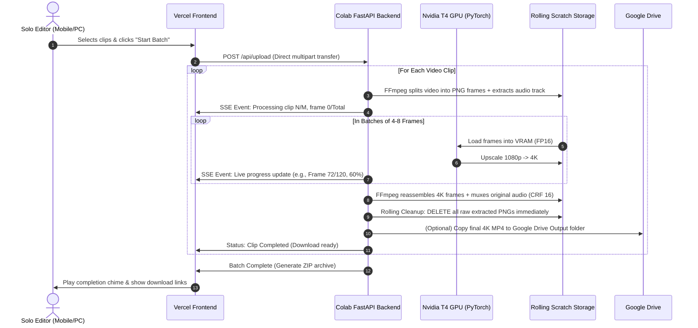

# Product Requirements Document (PRD): Anime Video Upscaler Platform

---

## 1. Executive Summary & Objective

### 1.1 Problem Statement
As an anime video editor, high-resolution source clips are frequently needed before assembling edits (AMVs, TikToks, Reels) in editing software (Premiere Pro, After Effects, CapCut, Alight Motion).
* Commercial AI upscalers (such as Vmake AI, Topaz, HitPaw) impose strict token paywalls, high subscription costs, and aggressive credit limits (often restricting users to 2–3 short clips on free tiers).
* General-purpose commercial tools often apply real-human skin smoothing and face-restoration models, which create an unnatural "waxy/plastic" look, blur anime line art, and distort 2D animation.
* Local hardware is severely constrained (running on a 20-year-old laptop without a modern discrete GPU), making local hardware-accelerated upscaling impossible.

### 1.2 The Solution
A **Decoupled Cloud-Powered Anime Video Upscaling Platform**:
1. **Compute Engine (Backend):** Free Google Colab hosting an Nvidia T4 GPU (16 GB VRAM) executing specialized open-source anime deep neural networks (`realesr-animevideov3`, `4x-AnimeSharp`).
2. **Secure Bridge:** A zero-cost, high-speed tunnel (Cloudflare Quick Tunnel) exposing the Colab backend without bandwidth caps or complicated port forwarding.
3. **Web Dashboard (Frontend):** A custom, high-craft dark-mode web application hosted 24/7 on Vercel (free tier), accessible across mobile phone (iOS/Android) and desktop browser.
4. **Permanent Storage:** Direct integration with Google Drive and local browser downloads (single `.mp4` and bundled `.zip`).

---

## 2. User Profile & Operating Model

### 2.1 User Persona
* **Solo Creator:** Independent anime video editor.
* **Primary Devices:** Mobile phone (smartphone running Chrome/Safari) for on-the-go clip processing and legacy 20-year-old laptop for timeline editing.
* **Editing Workflows:**
  * **Micro-Clips (90% of usage):** Upscaling short source cuts ($\le 5$ seconds each, 1080p Web-DLs from modern shows like *Jujutsu Kaisen*, *Demon Slayer*, *Chainsaw Man*) to native 4K before timeline editing.
  * **Macro-Edits (10% of usage):** Upscaling assembled final cuts (30–40 seconds) when master raw footage needs overall polish.

### 2.2 Quota & Session Optimization
* Google Colab provides ~3–4 hours of free continuous Nvidia T4 GPU compute per day on a single Google account.
* Because a 5-second clip takes only $\sim 20$ seconds to render, 3–4 hours of GPU allowance enables upscaling **hundreds of clips per day** at **\$0 total cost**.
* Strategic session management (starting Colab only when a batch is ready, and disconnecting when finished) ensures daily quotas are never exhausted.

---

## 3. System Architecture & Component Design

```
[ Solo Editor on Mobile / Laptop ]
            │
            ▼ (Visits permanent URL: https://anime-enhancer.vercel.app)
┌────────────────────────────────────────────────────────┐
│ 🎨 FRONTEND (Vercel Free Tier)                          │
│  - Modern Dark-Theme Dashboard                         │
│  - Multi-file Drag & Drop Batch Queue                  │
│  - Real-Time Progress Visualizer (Frames & ETA)        │
│  - Split-Screen Before/After Comparison Slider         │
│  - Direct Browser-to-Backend CORS Communication        │
└─────────────────────────────┬──────────────────────────┘
                              │ Direct Multipart Uploads (Bypasses Vercel 4.5MB limit)
                              ▼
┌────────────────────────────────────────────────────────┐
│ 🚇 SECURE TUNNEL (Cloudflare Quick Tunnel)             │
│  - Zero-configuration HTTPS tunnel                     │
│  - Free, encrypted, zero bandwidth throttling          │
└─────────────────────────────┬──────────────────────────┘
                              ▼
┌────────────────────────────────────────────────────────┐
│ ⚡ COMPUTE BACKEND (Google Colab - Nvidia T4 GPU)       │
│  - FastAPI REST + SSE (Server-Sent Events) Server      │
│  - PyTorch FP16 Inference Pipeline                     │
│  - Rolling Frame Extraction & Reassembly (FFmpeg)      │
│  - Google Drive Mounting (/content/drive/MyDrive)      │
└────────────────────────────────────────────────────────┘
```

---

## 4. AI Models & Image Processing Pipeline

### 4.1 Selected Model Architecture
The platform features two primary models and one fallback model pre-cached in memory:

| Preset Name | Model File | Architecture | Primary Use Case | Size & VRAM Footprint |
| :--- | :--- | :--- | :--- | :--- |
| **Fast Video (Default)** | `realesr-animevideov3` | Compact XS CNN | Fast everyday action clips; temporal consistency eliminates inter-frame line shimmering. | ~17 MB weights (~100 MB VRAM) |
| **Ultra-Sharp Line Art** | `4x-AnimeSharp` | Compact / ESRGAN | Dramatic close-ups, eye shots, fine inked lines, high-impact aesthetic cuts. | ~65 MB weights (~300 MB VRAM) |
| **Retro Restorer** | `RealESRGAN_x4plus_anime_6B` | 6-Block RRDB | Crunchy low-res rips (480p/720p), 90s/2000s anime, heavy compression noise. | ~17 MB weights (~250 MB VRAM) |

### 4.2 Resolution & Scale Strategy
* **Input Resolution:** Modern anime source footage is typically $1920 \times 1080$ (1080p).
* **Scaling Factor:** $2\times$ upscaling is the standard operational target:
  $$1920 \times 2 = 3840, \quad 1080 \times 2 = 2160 \implies \mathbf{3840 \times 2160 \text{ (Native 4K UHD)}}$$
* *Optimization Note:* Applying $4\times$ to 1080p produces 8K ($7680 \times 4320$), which introduces unnecessary render overhead and massive file sizes. $2\times$ scaling delivers the optimal balance of speed and 4K fidelity.

### 4.3 VRAM & Model Switching Dynamics
* All models are kept resident or lazy-loaded in PyTorch memory. 
* Total VRAM occupied by models in idle state is $<500\text{ MB}$ out of the $16,000\text{ MB}$ (16 GB) available on the Nvidia T4 GPU.
* **Idle GPU Load:** $0\%$ compute consumption when idle.
* **Switching Latency:** Instantaneous ($0.0\text{s}$) when switching presets via the web interface.

---

## 5. End-to-End Processing Pipeline

When submitting a clip or batch, the backend processes it in 4 strict stages:



### 5.1 Rolling Disk Cleanup Invariant
To prevent Colab's ephemeral hard disk from filling up during large batches (e.g., 20 clips $\times$ 120 frames $= 2,400$ high-res images):
* Intermediate extracted frames for Clip $N$ must be purged immediately once the final $4\text{K}$ `.mp4` container for Clip $N$ is assembled, before starting Clip $N+1$.
* Temporary disk usage never exceeds $\sim 300\text{ MB}$ regardless of batch size.

### 5.2 Video Encoding Specifications
* **Video Codec:** `libx264` (High Profile, Level 5.1).
* **Rate Control:** Constant Rate Factor `CRF 16` (visually lossless for video editing).
* **Pixel Format:** `yuv420p` (universal playback compatibility across iOS, Android, Premiere, After Effects, and CapCut).
* **Audio Handling:** Stream copy (`-c:a copy`) to preserve original audio frequency and bit rate with zero re-encoding loss or synchronization drift.

---

## 6. Functional Requirements (User Interface & Experience)

### 6.1 Connection & Pairing
* **Backend URL Input:** Top navigation bar contains a connection field for the Cloudflare URL (`https://xxxx.trycloudflare.com`).
* **Connection Status Pill:**
  * `🔴 Disconnected` — Server unreachable.
  * `🟡 Handshaking` — Testing ping and latency.
  * `🟢 GPU Online` — Displays GPU model (`Nvidia T4`) and free VRAM.
* **Persistent Cache:** Connection URL is saved to `localStorage` so refreshing the tab does not sever pairing.

### 6.2 Upload & Batch Queue
* **Drag-and-Drop Dropzone:** Supports simultaneous multi-file selection (`.mp4`, `.mov`, `.mkv`, `.webm`).
* **Queue Item Cards:**
  * Thumbnail preview.
  * File name, duration, and original resolution badge (`1080p`).
  * Model preset selector (override per clip or apply to all).
  * Status badge (`Queued`, `Processing`, `Completed`, `Failed`).
* **Batch Controls:**
  * "Start Batch" button.
  * "Clear Completed" button.
  * "Cancel / Abort" active process.

### 6.3 Real-Time Progress & Feedback
* **Dual Progress Bars:**
  * **Overall Batch Progress:** `Clip 3 of 8 (37%)`.
  * **Active Clip Progress:** Real-time frame indicator (`Frame 84 / 120 - 70% | ETA: 8s`).
* **Haptic & Audio Chime:** Pleasant sound effect and device vibration upon batch completion.

### 6.4 Preview & Download
* **Split-Screen Comparison Slider:** Interactive draggable before/after slider comparing original 1080p source with enhanced 4K output.
* **Export Actions:**
  * "Download All (.ZIP)" button.
  * Individual video download buttons.
  * "Save to Google Drive" instant sync toggle.

---

## 7. Performance Benchmarks & Targets

| Metric | Target Specification |
| :--- | :--- |
| **5-second 1080p Clip (120 frames)** | $\le 25\text{ seconds}$ total render time |
| **10-clip Batch (50s total footage)** | $\le 4.5\text{ minutes}$ total render time |
| **35-second Final Edit (840 frames)** | $\le 3.5\text{ minutes}$ total render time |
| **Colab Boot Time** | $\le 75\text{ seconds}$ from notebook start to tunnel active |
| **Client Memory Footprint** | $< 80\text{ MB}$ RAM on mobile browser |
| **Vercel Hosting Cost** | $\$0.00$ / month (Standard Hobby Tier) |
| **Google Cloud GPU Cost** | $\$0.00$ / month (Standard Colab Free Tier) |

---

## 8. Operational Runbook (Day-to-Day Workflow)

### Step 1: Session Initiation (When ready to upscale a batch)
1. Open the Google Colab notebook on mobile or desktop.
2. Select **Runtime $\to$ Run all** (takes $\sim 60$ seconds).
3. The notebook initializes the T4 GPU, starts FastAPI, launches Cloudflare Tunnel, and displays a link:
   `https://xyz-random-name.trycloudflare.com`

### Step 2: Dashboard Pairing
1. Open the permanent Vercel URL: `https://your-anime-upscaler.vercel.app`.
2. Paste the Cloudflare link into the top bar. The badge turns `🟢 GPU Online`.

### Step 3: Batch Execution
1. Drag and drop all raw 1080p cuts into the queue.
2. Select model preset (`animevideov3` for action, `AnimeSharp` for close-ups).
3. Tap **Start Upscale**.
4. Monitor live progress while doing other tasks.

### Step 4: Video Retrieval
1. Download all files directly as a `.zip` or retrieve them instantly from the Google Drive `/Finished_4K/` folder.
2. Import pristine 4K clips into the editing timeline.

### Step 5: Session Teardown
1. In Colab, click **Runtime $\to$ Disconnect and delete runtime**.
2. Preserves the daily compute quota for subsequent editing sessions.

---

## 9. Future Roadmap & Iterations (Post-v1.0)
* **Auto-Pairing via Key-Value Store:** Utilize a free Upstash Redis instance so Colab automatically updates its active tunnel URL, eliminating manual copy-pasting.
* **RIFE v4.x Frame Interpolation:** An optional toggle to interpolate 24 fps anime up to buttery 60 fps or ultra-smooth slow motion.
* **Local Webhook / Push Notification:** Send a browser notification when long batches finish rendering.
